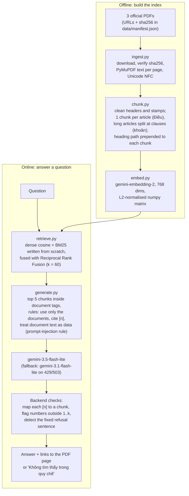

# HUST Regulation RAG

A question-answering chatbot over three official regulations of Hanoi University of Science and Technology (HUST, Đại học Bách khoa Hà Nội). It answers with numbered citations to the article and page, and refuses with a fixed sentence when the documents do not contain the answer. It is written in plain Python (no LangChain/LlamaIndex) on the Gemini API free tier. The emphasis is on measurement: retrieval metrics, manually graded answers, refusal behaviour and run-to-run consistency.

| Document | Number | Signed | PDF pages |
|---|---|---|---|
| Quy chế đào tạo (Academic Regulations) | 5445/QĐ-ĐHBK | 2025-05-28 | 34 |
| Quy định ngoại ngữ K71 (Foreign-language requirements, cohort K71) | 10828/QĐ-ĐHBK | 2026-09-07 | 23 |
| Quy định học phí năm học 2026–2027 (Tuition fees 2026–2027) | 12006/QĐ-ĐHBK | 2026-10-05 | 7 |

Example (question and answer are in Vietnamese, since the documents are):

> **Q:** *Em học chương trình chuẩn, đang bị cảnh báo học tập mức 2 thì một học kỳ chính được đăng ký tối đa bao nhiêu tín chỉ?*
> (Standard programme, academic warning level 2: how many credits can I register for in a main semester?)
>
> **A:** *Sinh viên thuộc chương trình chuẩn đang bị cảnh báo học tập từ mức 2 trở lên được đăng ký tối đa 14 tín chỉ cho một học kỳ chính [1].* (At most 14 credits.)
> [1] Quy chế đào tạo 5445/QĐ-ĐHBK, Điều 19. Cảnh báo học tập và buộc thôi học, pages 18–19

> **Q:** *Sinh viên thuộc hộ cận nghèo được giảm bao nhiêu phần trăm học phí năm học 2026–2027?*
> (What percentage tuition reduction do students from near-poor households get in 2026–2027?)
>
> **A:** *Không tìm thấy trong quy chế.* ("Not found in the regulations." The tuition decision only refers to national rules and gives no rate.)

<!-- Screenshot of the Streamlit app: to be added -->

## Results

All numbers below come from files in `results/` and were measured on 2026-11-16 with the final configuration: article-based chunks, hybrid retrieval, top 5 chunks, `gemini-3.5-flash-lite`, prompt frozen (see [Key decisions](#key-decisions-and-experiments)). The eval set is small, so read every number with the caveats in [Evaluation methodology](#evaluation-methodology) and [Limitations](#limitations).

### Answer quality

Eval set: 30 core questions (27 answerable, 3 with no answer in the documents) plus 7 "trap" questions with no answer: 37 questions in total, 27 answerable and 10 no-answer. Every question was asked 3 times. Answers were graded manually by the author (first run); all runs were checked automatically.

| Metric | Result |
|---|---|
| Answerable questions, graded manually (run 1) | 24 correct, 2 partially correct (q21, q24), 0 wrong, 0 fabricated, 1 false refusal (q11) — out of 27 |
| No-answer questions, graded manually (run 1) | 10/10 correct refusals, 0 fabricated |
| **Wrong or fabricated answers among questions the bot answered (main metric)** | **0 / 26** |
| Correct refusals, all runs (automatic) | 30/30 runs |
| False refusals, all runs (automatic) | 2/81 runs, both on q11 |
| Questions inconsistent across runs | 1: q11 (refused in 2 of 3 runs) |
| Citation numbers outside the retrieved set | 0 in 111 runs |
| A cited chunk contains the expected evidence passage | 79/79 non-refused runs on answerable questions |

The main metric is (wrong + fabricated) / (questions the bot did not refuse), because for regulations a confident wrong answer is worse than "not found". 0/26 does not mean the error rate is zero: with 26 answered questions, the usual 95% upper bound for zero observed errors (rule of three, 3/n) is about 11%. The two partially correct answers are incomplete rather than wrong (see [Limitations](#limitations)). Source: `results/grading_summary.json`, produced by `src/grading_summary.py` from `eval/GRADING.md`, `eval/GRADING_extra.md` and `results/answers_dieu_hybrid_runs3.json`.

### Retrieval

27 answerable questions, 111 article-based chunks vs 88 fixed-window chunks. A retrieved chunk counts as relevant if it contains at least one of the question's evidence passages verbatim (whitespace-insensitive). One question is worth 3.7 percentage points.

| Chunking + retrieval | Hit@1 | Hit@3 | Hit@5 | MRR@10 | Evidence recall@5 |
|---|---|---|---|---|---|
| article + dense | 0.815 | 0.963 | 0.963 | 0.895 | 0.926 |
| article + BM25 | 0.667 | 0.778 | 0.926 | 0.755 | 0.877 |
| **article + hybrid (used)** | 0.778 | 0.963 | **1.000** | 0.865 | **0.963** |
| window + dense | 0.741 | 0.926 | 0.926 | 0.836 | 0.870 |
| window + BM25 | 0.667 | 0.889 | 0.926 | 0.790 | 0.858 |
| window + hybrid | 0.778 | 0.926 | 1.000 | 0.854 | 0.935 |

Source: `results/retrieval_{dieu,window}_{dense,bm25,hybrid}.json` (`dieu` = article-based chunks).

### Latency and cost

Measured on the Gemini **free tier** on 2026-11-16, over the 81 LLM calls made in the final evaluation session (per-call numbers in `results/latency_final_session.json`):

| Step | Time |
|---|---|
| LLM call (`gemini-3.5-flash-lite`, minimal thinking) | p50 1.61 s, p95 2.77 s |
| Retrieval (dense + BM25 + RRF over 111 chunks, in memory) | p50 1.1 ms, p95 3 ms |
| Question embedding API call (first time a question is seen; cached afterwards) | about 0.44 s (mean over the 30 core questions) |

Free-tier latency varies between sessions: an earlier session on the same day had a median LLM latency of 9.2 s (`results/answers_dieu_hybrid.json`). The p95 stored in `results/answers_dieu_hybrid_runs3*.json` mixes in 32 answers cached from earlier sessions, 30 of them from that slower session, so it is not used above.

Tokens per question (30 core questions x 3 runs, `results/answers_dieu_hybrid_runs3_core30.json`): about 3,060 input, 64 output, 0 thinking. The project currently runs on the free tier (cost 0). On the paid tier, at USD 0.30 / 1M input and 2.50 / 1M output tokens (Google's price page, checked 2026-11-16), this would be about **USD 0.001 per question** (`cost_usd_per_question_if_paid` = 0.00108).

## Architecture



- **Ingestion.** PyMuPDF instead of pypdf, because pypdf broke Vietnamese diacritics on these PDFs. Text is normalised to NFC so that the same character always has the same bytes. The sha256 check fails loudly if a document on the university site changes.
- **Chunking.** Each chunk starts with the document title and its heading path (for example `Chương II > Điều 19. Cảnh báo học tập và buộc thôi học`), so both the embedding and BM25 see the context. Each chunk keeps its article number and PDF pages for citations. Appendix tables become chunks per table or sub-section.
- **Retrieval.** BM25 (K1 = 1.5, B = 0.75) on lower-cased syllables. Hybrid uses only ranks, not raw scores, so cosine and BM25 do not need to share a scale. Everything stays in memory in numpy; at about 100 chunks a vector database is not needed.
- **Generation.** Seven numbered rules in a Vietnamese system prompt. The refusal is a fixed string, so the backend can detect it with a prefix check and the eval can count refusals automatically. `<document>`/`<question>` tags are stripped from inputs so that a document cannot close its own tag. Prompt-injection resistance is not part of the eval set.
- **UI.** `app.py` (Streamlit) shows the answer, clickable sources that open the PDF at the cited page, the retrieved chunks with scores, latency and token counts, and lets you switch chunking, retrieval mode and k.

## Key decisions and experiments

**Article-based chunks vs fixed windows.** Regulations are organised by article (Điều) and clause (khoản), and students ask about one rule at a time. With dense and hybrid retrieval, article chunks were better or equal on every metric (dense Hit@1 0.815 vs 0.741, evidence recall@5 0.926 vs 0.870); with BM25 alone, windows did better on Hit@3 and MRR. Article chunks also give citable units ("Điều 19, pages 18–19"). The gaps are 1–2 questions out of 27, so the effect is small.

**Hybrid vs dense.** With article chunks, hybrid raised Hit@5 from 0.963 to 1.000 and evidence recall@5 from 0.926 to 0.963, but lowered Hit@1 (0.815 → 0.778) and MRR (0.895 → 0.865). I kept hybrid because the LLM reads all top 5 chunks, so recall at 5 matters more than rank 1. The Hit@5 gain is a single question.

**No cosine threshold for refusal.** The idea was to refuse when the best cosine score is low. On the article index, the top-1 cosine of the no-answer questions was 0.66–0.72, while answerable questions ranged from 0.70 to 0.82. The ranges overlap, so any threshold either refuses answerable questions or lets no-answer questions through. Refusal is left to the LLM through the fixed refusal sentence, and it is measured instead.

**Policy: a wrong answer is worse than a refusal.** For regulations about tuition, warnings and expulsion, a confident wrong answer can cause real harm, while "not found" sends the student to the source. The prompt therefore says to refuse when the documents are insufficient, and an occasional false refusal is accepted. A variant that allowed partial answers had no false refusals on the 27 answerable questions in one run and refused correctly in 6/6 no-answer runs. It was not adopted, because it relaxes the refusal rule and because one 27-question run is too little evidence to justify that.

**Ablation on q11, a false refusal.** q11 asks about IELTS requirements for the language graduation standard. The relevant article is retrieved at rank 3, but the bot says "not found". Hypothesis: rule 7 ("list all conditions and exceptions") combined with rule 4 ("refuse if the documents are insufficient") makes the model too cautious. Result, 3 runs per variant: the frozen prompt refused q11 in 3/3 runs. Removing rule 7 gave 0/3 refusals, but so did removing the unrelated rule 6 ("no LaTeX"), and so did **only swapping the order of rules 6 and 7**. The hypothesis was rejected: on this borderline question, flash-lite's answer-or-refuse decision flips with edits that have nothing to do with refusal. `gemini-3.5-flash` (the API reported `gemini-3.6-flash`) answered q11 correctly 3/3, but with a median latency of about 19 s. Conclusion: tuning the prompt further against this eval set would mostly fit noise, so the prompt was **frozen**, and q11 is reported as a known failure.

**Three runs per question.** `gemini-3.5-flash-lite` ignores `temperature`, so answers are not deterministic, and one run can hide instability (q11 refused 2/3 runs in the final eval). Every question is asked 3 times; the answer cache is keyed by question, run number, chunk-file hash and prompt hash, so re-runs only call the API for missing or outdated answers.

## Evaluation methodology

- **Core set, 30 questions** (`eval/questions.jsonl`): 15 single-article, 5 numeric, 4 multi-part, 3 colloquial (slang, missing diacritics), 3 with no answer in the documents. Each answerable question has a reference answer, source pages and verbatim evidence passages (58 in total).
- **How the core set was built.** The questions and reference answers were drafted with an LLM from the PDF text. The author checked **8 questions (q01–q08) by hand** against the PDFs. The other **22 were accepted without a manual check**, after an automatic check that **all 58/58 evidence passages appear verbatim** in the PDF text. The `review` field records this per question (`manual` or `accepted`).
- **Trap set, 7 no-answer questions** (`eval/questions_extra.jsonl`, `review: manual`): a wrong year (tuition for 2025–2026, while only 2026–2027 is covered), a wrong cohort (K70, while the language regulation applies from K71), administrative questions the documents do not cover (a lost student card, health insurance), and details beyond what they say (a tuition-reduction rate, a payment deadline, a placement-test fee). Two are written colloquially. Each was drafted with keyword searches over the extracted text and reviewed by hand by the author.
- **Grading.** Answers were graded manually by the author (first of the 3 runs; `eval/GRADING.md`, `eval/GRADING_extra.md`). Consistency across the 3 runs is measured automatically: refusal is detected by the fixed sentence, citations by number.
- **Automatic checks.** Invalid citation = a number outside 1..k; cited evidence = at least one cited chunk contains an evidence passage. These are hints for the grader, not a substitute for grading.

## Limitations

- **Small eval set.** 37 questions: 27 answerable and 10 no-answer; one answerable question is 3.7 percentage points. The differences between retrieval configurations are 1–2 questions.
- **Reference answers are mostly unverified.** They were drafted with an LLM; only 8 of the 30 core questions were checked by hand against the PDFs. Only the first of the 3 runs was graded manually.
- **Changes made after reading eval outputs** (overfitting risk, which is why the prompt is now frozen):
  - Prompt rules 6 (plain text, no LaTeX) and 7 (state all conditions and exceptions) were added after reading answers on the eval set.
  - The chunker was fixed to keep the I./II./III. heading levels in the tuition appendix, after the bot confused the part-time tuition rate (500 thousand VND per credit) with the full-time one (700).
  - One overly generic evidence passage was removed from q13.
  - Retrieval numbers above were measured after these changes; numbers on the earlier draft set are in `results/draft/`.
- **q11 is unstable.** It is a false refusal in 2 of 3 runs, even though the relevant article is retrieved at rank 3.
- **Completeness varies between runs.** q04's run-1 answer mentions the exception for oral exams, but runs 2 and 3 do not.
- **Cross-document questions.** For q21 (graduation conditions plus the language requirement), the top 5 chunks covered only 1 of 4 evidence passages, all from the language regulation, and the answer covers only the language requirement (graded partially correct).
- **Indirect answers.** q24 asks whether a 12-student retake class can be opened; the answer gives the fee multiplier and who decides, but does not state that classes of 5–19 students can be considered (graded partially correct).
- **Tables with merged cells** are flattened out of column order by text extraction, for example the certificate conversion table (IELTS, TOEIC, ...) and a tuition figure. `page.find_tables()` from PyMuPDF would be the next step; it is not done.
- **Page offset.** The chunk for Table 4.1 of the language regulation (`ngoaingu_k71:body:u18:0`) is labelled page 12, but the note about the placement test inside it is on page 13.
- **Scope.** Only 3 documents. Questions about other regulations, such as discipline or dormitories, are expected to be refused.
- **Free tier.** All latency numbers are from the free tier on a single day. On the free tier Google may use requests to improve its products; the documents here are public.

## How to run

Requires Python 3.11 and a Gemini API key from [Google AI Studio](https://aistudio.google.com). Commands are for Windows PowerShell; on macOS/Linux use `.venv/bin/activate` and `cp`. The `-X utf8` flag avoids `UnicodeEncodeError` when Vietnamese output is redirected on Windows.

```powershell
py -3.11 -m venv .venv
.\.venv\Scripts\Activate.ps1
pip install -r requirements.txt
copy .env.example .env               # then set GEMINI_API_KEY in .env (never commit it)

# Build the index
python -X utf8 -m src.ingest         # download the 3 PDFs (sha256-checked) -> data/processed/pages.jsonl
python -X utf8 -m src.chunk          # -> data/processed/chunks_dieu.jsonl and chunks_window.jsonl
python -X utf8 -m src.embed          # embed both chunk sets -> data/index/ (skipped if chunks are unchanged)

# Ask
python -X utf8 -m src.generate "trượt cuối kỳ thì có đc thi lại ko ạ"   # "failed the final, is there a retake?"
streamlit run app.py
```

Evaluation:

```powershell
python -X utf8 -m src.eval_retrieval     # 6 chunking x retrieval combinations -> results/retrieval_*.json
python -X utf8 -m src.eval_answers dieu hybrid --runs 3 --questions eval/questions.jsonl eval/questions_extra.jsonl
python -X utf8 -m src.grading_summary    # combine hand grades + automatic numbers -> results/grading_summary.json

# quick test on a few questions (does not touch the grading sheet; metrics go to a *_partial.json file)
python -X utf8 -m src.eval_answers dieu hybrid --only q11,q28 --runs 2
```

Notes:

- Put `config mode` (`dieu hybrid`) **before** `--questions`, because `--questions` takes several files.
- `results/answers_dieu_hybrid.jsonl` is an append-only answer cache. Answers are reused only if the chunk file and the prompt have the same hashes, so a fresh run on unchanged data makes no new LLM calls for cached answers.
- If a grading sheet already has ticks, `eval_answers` writes `eval/GRADING_new.md` instead of overwriting it.
- On HTTP 429/503 the code retries and may fall back to `gemini-3.1-flash-lite` without stopping. Check `models_used` in the result file; in the final run every call was answered by `gemini-3.5-flash-lite`.
- The free tier allows about 100 embedding texts per minute, so building the index may pause for a minute.

## Project structure

```
app.py                       Streamlit UI
requirements.txt             pinned dependencies
.env.example                 template for GEMINI_API_KEY
data/manifest.json           URL, number, signing date, scope and sha256 of each PDF + per-document cleaning rules
src/
  ingest.py                  download PDFs (cached, sha256-checked), extract text per page
  chunk.py                   clean pages; build article-based ("dieu") and fixed-window ("window") chunks
  embed.py                   Gemini embeddings -> numpy index; on-disk cache of question embeddings
  retrieve.py                dense, BM25 (from scratch), hybrid with RRF
  generate.py                prompt, Gemini call with fallback model, citation check, refusal
  eval_retrieval.py          Hit@k, MRR@10, evidence recall@5 for the 6 combinations
  eval_answers.py            N runs per question: refusal/citation metrics, latency, tokens; writes the grading sheet
  grading_summary.py         combine hand grades with automatic multi-run numbers
eval/
  questions.jsonl            30 core questions (review: manual | accepted)
  questions_extra.jsonl      7 no-answer trap questions (review: manual)
  questions_draft.jsonl, questions_extra_draft.jsonl   drafts before review
  GRADING.md, GRADING_extra.md                         hand-grading sheets (run 1)
results/
  retrieval_*.json           retrieval metrics on the core set; draft/ = earlier draft set
  answers_dieu_hybrid.jsonl  append-only cache of every LLM answer, with the retrieved chunks
  answers_dieu_hybrid_runs3.json         final run: 37 questions x 3 runs
  answers_dieu_hybrid_runs3_core30.json  30 core questions x 3 runs (token and cost numbers)
  answers_dieu_hybrid.json   first single run on the draft set (superseded)
  grading_summary.json       output of src/grading_summary.py
  latency_final_session.json per-call latency of the final evaluation session
```

`data/raw/` (PDFs), `data/processed/` and `data/index/` are generated and not committed.
